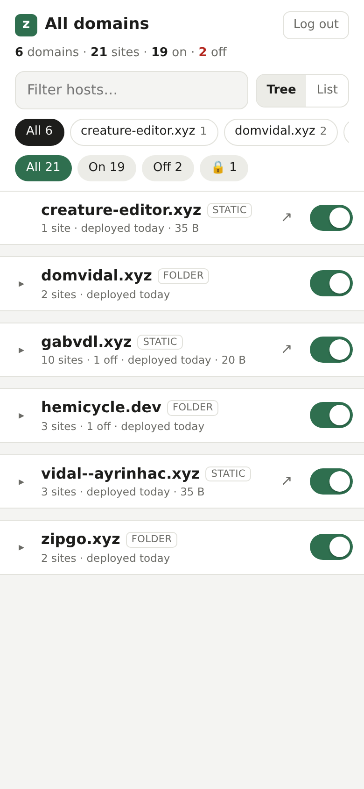
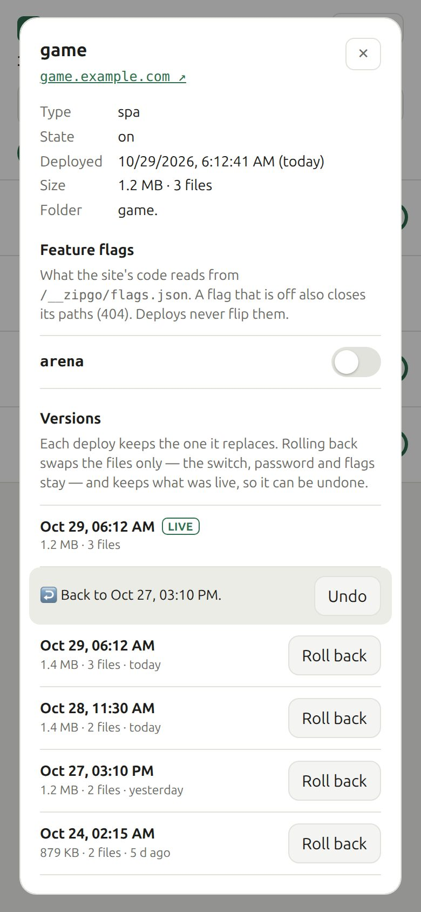

# zipgo


A minimal static site host powered by [Caddy](https://caddyserver.com/) and Go. Drop a domain folder into `.zipgo/` and your sites are live — with automatic HTTPS via Let's Encrypt, or on localhost with zero config.

---

## Architecture


## Features

- **Drop-in deploy** — create a domain folder under `.zipgo/`; changes are picked up automatically
- **Automatic HTTPS** — Let's Encrypt certificates managed by Caddy, no configuration needed
- **Filesystem-as-config** — the folder tree _is_ the routing table; no config files to maintain
- **Recursive subdomains** — a folder ending in a dot (`docs.`) becomes a subdomain; nest them for sub-subdomains
- **Multiple domains** — host several domains at once, each in its own folder
- **SPA support** — auto-detected; all unknown paths fall back to `index.html`
- **Custom 404 page** — drop a `404.html` in a static site's folder and it becomes the body of its 404s
- **Password-protected sites** — `zipgo password set <host>` puts a whole site behind a login page (one shared password, a session cookie); deploys keep the lock. `"basicAuth"` is there too for HTTP basic auth
- **Switch a site off** — `zipgo off <host>` takes a deployed site down (410 Gone, nested subdomains included) without deleting it; `zipgo on <host>` brings it back
- **Deploy history & rollback** — every `zipgo deploy` keeps the site's previous content (last 5, `--keep N`) in a hidden `.zipgo-versions/` folder; `zipgo rollback <host>` puts the previous deploy back, reversibly
- **Back-office** — `zipgo admin set admin.yourdomain.com` gives a domain a password-protected page, made for a phone, to switch any of its sites (sub and sub-sub domains included) off and on, flip their feature flags, put a password on one and roll one back to an earlier deploy; `--all` makes it the one page for every domain on the server. It edits the same `.zipgoconfig.json` files the CLI does — no state of its own
- **Feature flags** — a site declares switches for unfinished features; its code reads them from `/__zipgo/flags.json`, zipgo answers 404 on the paths of the ones that are off, and you flip them from the back-office or `zipgo flag` — no redeploy, and deploys never flip them back
- **Localhost mode** — no domain needed; all sites served on a single port (`9000`) with path routing
- **Systemd integration** — `zipgo enable` sets up a user service that starts on boot

---

## Requirements

- Go 1.21+
- A server with ports 80/443 open (for domain mode), or just a local machine (for localhost mode)
- DNS records pointing each domain (and its subdomains) to your server (domain mode only)

---

## Quick Start

### Localhost (no domain, no sudo)

```bash
git clone https://github.com/GabrielVidal1/zipgo
cd zipgo
make run-local
```

In localhost mode every site is reachable on a single port under a path that mirrors its host:

| URL                                        | What                          |
| ------------------------------------------ | ----------------------------- |
| `http://localhost:9000/yourdomain.com`     | The apex site                 |
| `http://localhost:9000/yourdomain.com/docs`| The `docs.` subdomain         |

### Domain mode

```bash
# 1. Create a domain folder and point its DNS records at your server
mkdir -p .zipgo/yourdomain.com
echo "<h1>hello</h1>" > .zipgo/yourdomain.com/index.html

# 2. Run (needs ports 80/443)
make run
```

| URL                              | What                  |
| -------------------------------- | --------------------- |
| `https://yourdomain.com`         | The apex site         |
| `https://docs.yourdomain.com`    | The `docs.` subdomain |

---

## Directory Layout

The domains folder (default `.zipgo/`, override with `ZIPGO_DOMAINS_FOLDER`) holds one folder per domain. **A domain folder name must contain a dot** — folders without one are ignored.

```
.zipgo/
└── yourdomain.com/            # one folder per domain (name must contain a dot)
    ├── index.html             # the apex site — served at yourdomain.com
    ├── assets/                # regular content, served as a path under the apex
    ├── docs./                 # → docs.yourdomain.com
    │   ├── index.html
    │   └── api./              # → api.docs.yourdomain.com  (recursive)
    └── blog./                 # → blog.yourdomain.com
```

### Subdomain rule

Inside a domain folder, **any subdirectory whose name ends in a dot is a subdomain**. The label is the name with the trailing dot removed, and the rule applies recursively:

| Folder                              | Host                          |
| ----------------------------------- | ----------------------------- |
| `yourdomain.com/` (the root itself) | `yourdomain.com`              |
| `yourdomain.com/docs./`             | `docs.yourdomain.com`         |
| `yourdomain.com/docs./api./`        | `api.docs.yourdomain.com`     |
| `yourdomain.com/foo.bar./`          | `foo.bar.yourdomain.com`      |

Folders that do **not** end in a dot are treated as ordinary content of their parent site (served as paths). Subdomain folders are hidden from the apex's directory listing, so they don't leak into `https://yourdomain.com/`.

### Site structure

The domain folder root is the apex site; each subdomain folder is its own site.

```
yourdomain.com/
├── index.html         # entry point
├── 404.html           # optional — the body of this site's 404s
├── assets/            # presence of this (or static/, _next/, dist/) marks the site as an SPA
└── ...
```

**SPA detection** — a site is treated as a single-page app when it contains `index.html` **and** one of the bundler output directories: `assets/`, `static/`, `_next/`, `dist/`. All unmatched paths are rewritten to `/index.html`.

**Custom 404 page** — a static site with a `404.html` in its folder serves that
file, instead of Caddy's plain-text 404, for any request that matches no file.
Nothing to configure: the file being there *is* the config. The status stays
**404** — only the body changes, so crawlers and `curl -f` still see a miss
rather than a soft 404. It applies per site (a subdomain does not inherit its
parent's page) and only to a static one: an SPA answers unknown paths with
`index.html` and a 200, and `rewrite`/`redirect` sites never reach the file
server — `zipgo doctor` warns when a `404.html` sits in one of those folders,
where it would never be served.

### Per-site config (`.zipgoconfig.json`)

Drop a `.zipgoconfig.json` file in any domain/subdomain folder to tweak how that
single site is served. The file is never served to clients (the file server
hides it). All keys are optional:

```jsonc
{
  "enable": true,                  // false → switch the site off: 410 Gone for
                                   //   it and every subdomain nested under it
                                   //   (`zipgo off <host>` writes this for you)
  "rewrite": "localhost:8080",     // reverse-proxy to this upstream instead of
                                   //   serving files (host:port, or a URL with
                                   //   scheme: "https://api.example.com")
  "rewritePath": "/_/",            // prefix the proxied path, so a sub-path of
                                   //   the upstream is served at this site's
                                   //   root (needs "rewrite")
  "rewritePathPassthrough": ["/api"], // paths the upstream owns at its root, so
                                   //   they are NOT moved under "rewritePath"
                                   //   (default ["/api"])
  "redirect": "https://elsewhere.example", // redirect every request to this URL
                                   //   instead of serving files
  "redirectStatus": 302,           // status used for "redirect" (default 302;
                                   //   301/308 permanent, 302/307 temporary)
  "allowHttp": false,              // true → also serve over plain HTTP (:80)
                                   //        instead of redirecting to HTTPS
  "headers": {                     // extra response headers, merged into the
    "Cache-Control": "public, max-age=31536000, immutable"
  },                               //   security headers zipgo already sends
  "browse": false,                 // true → a folder with no index.html lists
                                   //   its files (default: 404; never on an SPA)
  "admin": false,                  // true → this folder is the back-office of
                                   //   the site it is nested in; "all" → of
                                   //   every domain on the server (needs a
                                   //   "password"; `zipgo admin set` writes both)
  "password": {                    // a login page in front of the whole site
    "hash": "$2a$12$Zkx19XLiW…",   //   *bcrypt hash* of the shared password
    "title": "Ballance",           //   the login page's heading (default: host)
    "sessionDays": 7               //   how long a login lasts without a visit
  },                               //   (`zipgo password set` writes all this)
  "basicAuth": {                   // or HTTP basic auth
    "alice": "$2a$14$Zkx19XLiW…"   //   username → *bcrypt hash*, never a
  },                               //   plaintext password
  "flags": {                       // feature flags, served at
    "daily": true,                 //   /__zipgo/flags.json (see below)
    "coop": {"on": false, "description": "Co-op levels", "paths": ["/coop"]}
  }
}
```

- **`browse: true`** turns on directory listings for the folders of a static
  site that have no `index.html`. Off by default: a listing shows every file a
  build left behind, so a path with no page answers 404 (or the site's own
  `404.html`) unless the site asks to list. An SPA never lists — every path is
  `index.html`.
- **`enable: false`** switches the site off without deleting it: every request
  gets a small **410 Gone** page (with `Cache-Control: no-store`, so nothing
  lingers once it's back on), it keeps its TLS certificate so visitors see that
  page rather than a certificate error, and it disappears from its parent's
  `/sub-domains-meta` listing. It **cascades**: every subdomain nested under the
  folder goes off with it (`app./pb./` is off when `app./` is), and an
  `"enable": true` further down cannot override that. You rarely write it by
  hand — [`zipgo off`](#zipgo-off--zipgo-on) does it over SSH and keeps the
  file's other keys.
- **`rewrite`** makes the site a reverse proxy: requests are forwarded to the
  given upstream rather than served from the folder (no `index.html` needed). A
  bare `host:port` dials plain HTTP; a `https://` URL proxies over TLS.
- **`rewritePath`** prepends a path to every proxied request, so a sub-path of an
  upstream is served at this site's root while the browser's URL stays on this
  host (unlike a `redirect`, which bounces the address bar). The motivating case
  is an admin UI that lives under a prefix — PocketBase serves its dashboard at
  `/_/`, so:

  ```jsonc
  // domains/example.xyz/admin./.zipgoconfig.json
  { "rewrite": "app-pocketbase:8090", "rewritePath": "/_/" }
  ```

  puts the dashboard on `https://admin.example.xyz/` instead of
  `https://pb.example.xyz/_/`.

  The prefix is **not** applied to a request that already starts with it, nor to
  the paths in `rewritePathPassthrough` — the app under the prefix usually still
  calls the upstream's *root* paths (PocketBase's dashboard fetches `/api/…`
  absolutely), and prefixing those to `/_/api/…` would 404, so the dashboard
  would load but never log in. The default passthrough is `["/api"]`, which
  covers that case; set it explicitly for a different upstream, or to `[]` to
  prefix everything. `rewritePath` needs `rewrite` — `doctor` warns when it is
  set on a site that isn't a proxy.
- **`redirect`** turns the host into a redirect (no `index.html` needed — this is
  the replacement for the `<meta http-equiv="refresh">` trick). The target must
  be an **absolute** `http(s)` URL:
  - a bare origin — `"https://elsewhere.example"` — **keeps the path and query**,
    so deep links survive a domain move: `/blog/post?x=1` →
    `https://elsewhere.example/blog/post?x=1`;
  - a target with a path — `"https://elsewhere.example/moved"` — is used
    verbatim: every request lands on that one URL.

  A bare path (`"/new"`) is rejected: a redirect replaces the site's file server,
  so it would redirect to itself forever. `redirect` also wins over `rewrite` —
  `doctor` errors when both are set.
- **`redirectStatus`** picks the status code — `301`/`308` (permanent) or
  `302`/`307` (temporary). It defaults to **302**: browsers cache a 301 for a
  long time, and in a folder-tree config a redirect should be as easy to undo as
  the file that declared it. Set `301` once the move is final.
- **`allowHttp: true`** serves the site on port 80 as well as 443 (by default
  every host is 301-redirected to HTTPS). No effect in localhost mode, which is
  already HTTP-only.
- **`headers`** sets extra response headers on every request to the site —
  caching, CORS, anything — without putting a proxy in front of it. They are
  **merged into** the security headers zipgo already sends (`X-Frame-Options`,
  `X-Content-Type-Options`, `Referrer-Policy`, `X-XSS-Protection`,
  `Permissions-Policy`), not a replacement for them: an entry whose name matches
  one of those defaults overrides that one header and leaves the rest alone.
  Header names are case-insensitive (`cache-control` and `Cache-Control` are the
  same header), and an **empty value removes** a header instead of sending it
  blank:

  ```jsonc
  {
    "headers": {
      "Cache-Control": "public, max-age=31536000, immutable",  // add
      "Access-Control-Allow-Origin": "https://app.example.com",// CORS, no proxy
      "X-XSS-Protection": "1; mode=block",                     // override a default
      "Referrer-Policy": ""                                    // remove a default
    }
  }
  ```

  A `headers` value that isn't an object of strings, a name that isn't a valid
  header token, or a value containing a newline is a hard error — the same
  contract as any malformed `.zipgoconfig.json` (see below). `zipgo doctor`
  points at the file.

  Headers apply to every kind of site: on a `rewrite` proxy they override
  whatever the upstream sent, and on a `redirect` they ride along with the 301/302.
- **`password`** puts the whole site behind zipgo's login page — see
  [Password-protected sites](#password-protected-sites). You set it with
  `zipgo password set <host>` rather than by hand.
- **`basicAuth`** puts the site behind HTTP basic auth — one file turns a
  staging subdomain into a password-protected one. Keys are usernames, values
  are **bcrypt hashes** (`caddy hash-password`, or `htpasswd -nbB alice s3cret`
  and keep the `$2y$…` part). Plaintext passwords are never accepted: Caddy
  compares against a hash, so a plaintext value locks *everyone* out — `doctor`
  reports it as an error.

  The check runs before anything is served, so it protects static files, SPA
  routes, a `rewrite` upstream and the site's own `/sub-domains-meta` listing
  alike. Child subdomains are **separate sites** and are not covered — give each
  one its own `basicAuth` (they can share the same hash).

```bash
# retire old.example.com, keeping every deep link working
mkdir -p .zipgo/example.com/old.
echo '{"redirect": "https://new.example.com", "redirectStatus": 301}' \
    > .zipgo/example.com/old./.zipgoconfig.json

# password-protect staging.example.com
mkdir -p .zipgo/example.com/staging.
echo "{\"basicAuth\": {\"alice\": \"$(htpasswd -nbB alice s3cret | cut -d: -f2)\"}}" \
    > .zipgo/example.com/staging./.zipgoconfig.json
```

Edits are picked up by the file watcher and hot-reloaded like any other change.

### Password-protected sites

One shared password in front of a whole site — a game in progress, a share
with a few people — with a real login page rather than the browser's
basic-auth dialog:

```bash
zipgo password set ballance.game.example.com --title "Ballance"   # prompts twice
zipgo deploy dist -d ballance.game.example.com                     # still locked
```

- **Every path** answers `401` with the same small login page until the
  visitor has a session: the index, every asset, `/sub-domains-meta`, a 404.
  Nothing of the site is served before the password. The page is generic —
  only its title changes — `noindex`, `no-store`, with a strict CSP.
- The right password sets a **session cookie** (`__Host-`, `Secure`,
  `HttpOnly`, `SameSite=Lax`) and sends the visitor back to the page they
  asked for. It lasts `sessionDays` (default **7**) and is **renewed while in
  use**, so someone who keeps coming back never sees the page again.
  `/__zipgo/logout` ends it.
- A **link can skip the page**: any URL with `?__zipgo_pwd=<password>`
  (e.g. `https://ballance.game.example.com/?__zipgo_pwd=…` in a kiosk or a
  Steam shortcut) is checked like the form, with the same throttle; the right
  password sets the session and `303`s to the same URL **without** the
  parameter, so it doesn't linger in the address bar or a `Referer`. GET/HEAD
  only; the site never sees the parameter. Mind that a password in a link can
  end up in browser history and proxy logs.
- **Changing the password logs everyone out.** Sessions are signed with a key
  derived from a server secret (kept next to the certificates, in Caddy's data
  dir: it survives restarts), the host and the password hash — and every new
  hash has a new salt. A cookie never opens another site.
- Wrong passwords are **throttled**: 10 a minute per visitor IP, 60 a minute
  per site, then `429` for the rest of the minute. Behind a TCP proxy, set
  [`ZIPGO_PROXY_PROTOCOL_ALLOW`](#behind-a-tcp-proxy-proxy-protocol) so zipgo
  sees real visitor IPs. Logins and throttling are logged.
- Only a **bcrypt hash** is stored, never the password. A `password` block whose
  hash is missing or unusable **fails closed**: the site stays locked and nobody
  gets in (`zipgo doctor` says so).
- A locked site is **HTTPS-only** (`allowHttp` is ignored), its responses get
  `Cache-Control: private, no-cache` and `X-Robots-Tag: noindex, nofollow`
  (override them with `headers`), and it is **left out of its parent's
  `/sub-domains-meta`**, so its title and description don't leak through a
  public feed. A `basicAuth` site is left out too.
- zipgo picks the site by `Host` header whatever the TLS SNI, and the check
  runs inside the host's own route, so a domain-fronted request (SNI of a
  public site, `Host` of a locked one) gets the login page as well.
- **Deploys keep the lock.** `zipgo deploy` never removes or overwrites a
  site's `password` (or `basicAuth`): the mirror leaves the server's
  `.zipgoconfig.json` alone, and a build that ships its own has the server's
  lock merged back in. A build can't unlock a site or change its password —
  `zipgo password` is the one way.
- Child subdomains are separate sites: each needs its own password.

See [`zipgo password`](#zipgo-password) for the commands.

### Feature flags

Switches for features that aren't ready for everyone, flipped on the server
without a redeploy:

```jsonc
// the site's .zipgoconfig.json — ship it in the build (Vite: public/)
{
  "flags": {
    "coop":  {"on": false, "description": "Co-op levels"},
    "arena": {"description": "The arena", "paths": ["/arena"]},
    "daily": true
  }
}
```

```js
// the site's code, at boot
const { flags } = await fetch("/__zipgo/flags.json").then((r) => r.json());
if (flags.coop) showCoopButton();
```

- A site with a `flags` block (even an empty one) serves
  **`/__zipgo/flags.json`** → `{"flags": {"coop": false, "arena": false,
  "daily": true}}`, `Cache-Control: no-store`, so a switch takes effect on the
  next page load. Without the block, the path is the site's own (an SPA
  answers it with `index.html`) — so code that reads flags should treat
  anything but JSON as "every flag off" on a real host.
- A flag is `true`/`false`, or an object: `on` (default **false** — a feature
  is unreleased until someone flips it), a `description` the back-office shows,
  and `paths`. While a flag is **off**, zipgo answers **404** on each of its
  `paths` and everything under them (`/arena` covers `/arena/` and
  `/arena/x.js`), before the site's files, SPA fallback or upstream — so a
  feature with pages of its own can't be reached by URL either. A path is a
  plain prefix; `/` is refused (switch the site off instead).
- On a **locked** site the endpoint and the 404s are behind the login page,
  like everything else.
- **The build declares, the server decides.** A deploy never changes a flag's
  switch: a server config with `flags` is left out of the mirror, and the
  build's own `flags` are merged in — a flag new to the server arrives as the
  build ships it (off unless it says `on`), an existing one keeps the server's
  switch and takes the build's description and paths (when the build writes it
  as an object), and a flag only the server has is kept.
- Flip them from the [back-office](#back-office) (the site's details) or with
  [`zipgo flag`](#zipgo-flag). Names are a letter then up to 63 letters,
  digits, `-` or `_`.

### Back-office

A page to switch sites off and on from a phone, behind the same login page —
one per domain, or one for every domain on the server:

```bash
zipgo admin set admin.yourdomain.com --generate         # prints the password once
# → https://admin.yourdomain.com manages yourdomain.com
zipgo admin set admin.yourdomain.com --all --generate   # every domain instead
```

 

- It manages **the site its folder is nested in and every subdomain under it**:
  `admin.yourdomain.com` (folder `yourdomain.com/admin./`) lists the apex and
  every sub and sub-sub domain. Put one at `dev./admin./` and it manages
  `*.dev.yourdomain.com` only.
- With **`--all`** (`"admin": "all"`) it manages **every domain in the domains
  folder** instead: each domain is a root of the tree — folded by default, its
  row says how many sites it holds and how many are off, and its switch takes
  the whole domain off — and a row of domain chips narrows the page (counts
  included) to one. The list view groups by domain. A domain folder added
  later shows up on the next load. It can live on any host, even the apex of
  a domain of its own.
- Each site gets a **switch**. Off writes `"enable": false` into the site's
  `.zipgoconfig.json` — exactly what [`zipgo off`](#zipgo-off--zipgo-on)
  writes — so the site answers 410 and its nested subdomains go with it (they
  show *off through …*). Every switch has an **Undo** for five seconds.
- A **tree** view (collapsible, the nesting at a glance) and a **list** view
  (one row per host, grouped by top-level label), a search box, and *On / Off
  / 🔒* filters. Each row shows the type (static, SPA, proxy, redirect), the
  lock, when the site was last deployed and its size, and opens the site.
- A site with [feature flags](#feature-flags) shows `⚑ on/total` on its row
  (and a *⚑* filter); its details list each flag with its description, the
  paths it closes while off and a **switch** — the same edit as
  [`zipgo flag on|off`](#zipgo-flag), with an Undo.
- Tapping a site opens its details and its **password**: set one, generate
  one (shown once), change it or take it off — the `password` block that
  [`zipgo password`](#zipgo-password) writes, so deploys keep it too.
- A site that serves files lists its **versions**: what is live, then the
  deploys [`zipgo deploy`](#zipgo-deploy) kept in `.zipgo-versions/`, newest
  first, with their size. **Roll back** puts one back — what
  [`zipgo rollback`](#zipgo-rollback) does, on the server's own disk: the files
  only (the switch, the password and the flags stay as they are, nested
  subdomains are left alone), and what was live is kept as a version first, so
  the rollback has an **Undo**.

  
- It is **not a second source of truth**: it has no database, reads the folder
  tree on every request and writes `.zipgoconfig.json` files the watcher
  hot-reloads, so the page, the CLI and `zipgo ls` always agree. No upload and
  no delete: deploys stay `zipgo deploy`'s job (a rollback only puts back what
  a deploy kept).
- It **fails closed**: an `"admin": true` folder without a `password` answers
  `403` and serves nothing. It can't switch itself off, and it is **not**
  taken down when its parent is switched off — it is how the domain gets
  switched back on. It is never listed in `/sub-domains-meta`.
- Writes are same-origin JSON `POST`s only (the session cookie is
  `SameSite=Lax`, cross-site requests are refused), the page is `no-store`,
  `noindex`, framed by nobody, and sends no `Referer` to the sites it links to.
- When zipgo runs as root (the Docker image), a config it writes is handed to
  the folder's owner, so `zipgo off` and deploys over SSH can still replace it.

---

## Deploying a Site

Copy your build output into the right folder. The file watcher picks up changes automatically and reloads Caddy:

```bash
# apex
cp -r dist/* .zipgo/yourdomain.com/

# a subdomain (note the trailing dot)
cp -r dist/ .zipgo/yourdomain.com/app./
```

---

## CLI

```bash
zipgo serve     # start the server (default when no command is given)
zipgo deploy    # rsync a local dir to a remote zipgo host over SSH
zipgo ls        # list sites deployed on the remote target
zipgo info      # show a deployed site's remote path, size and mtime
zipgo off       # switch a deployed site off (410 Gone, nested sites too)
zipgo on        # switch it back on
zipgo password  # put a site behind a login page, rotate or remove its password
zipgo admin     # set up a domain's back-office (a page to switch its sites off/on)
zipgo flag      # list, switch, add or remove a site's feature flags
zipgo rollback  # swap a previous deploy back into place (--list for history)
zipgo doctor    # check the local domains folder for broken sites
zipgo enable    # install and start the systemd user service
zipgo disable   # stop and remove the systemd user service
zipgo status    # show service status
zipgo version   # print the version
zipgo help      # usage
```

### `zipgo deploy`

Push a local build to a remote zipgo host. It creates the domain/subdomain
folder tree (the trailing-dot convention above) on the remote and rsyncs the
directory's contents into it:

```bash
zipgo deploy dist/ -d love-letters.game.gabvdl.xyz \
    --ssh gabrielvidal@100.74.118.12:/home/gabrielvidal/services/domains
# -> creates  .../domains/gabvdl.xyz/game./love-letters.
#    serving   https://love-letters.game.gabvdl.xyz  (zipgo hot-reloads)
```

`-d/--domain` is repeatable (deploy the same build to several hosts). Flags:
`--ssh/--target user@host:/base/path`, `--exclude <pat>` (repeatable),
`--delete`/`--prune` (mirror — delete remote files missing from the source;
this is the default, `--prune` is just a clearer name for it), `--no-delete`
(keep them), `--include-subdomains` (let the mirror also delete nested
trailing-dot subdomain folders; by default they're protected), `-n/--dry-run`.

A deploy ships **files, never server state**: a site that is
[switched off](#zipgo-off--zipgo-on) stays off and a
[password-protected](#password-protected-sites) one stays locked. The mirror
leaves such a site's `.zipgoconfig.json` alone, and a build that ships its own
gets the switch and the lock merged back in (`🔒 password kept: the site stays
locked` in the output).

A `--dry-run` **previews exactly what would change and touches nothing** — it
runs the same rsync with `--itemize-changes` and prints a per-host summary of
which files would be added, replaced and deleted, so you can eyeball a mirror
before it prunes the remote:

```text
🌐  app.dev.gabvdl.xyz
   → user@host:/base/gabvdl.xyz/dev./app.
   dry run — 2 added, 1 replaced, 1 deleted:
     ＋ add      assets/app-9f3.js
     ＋ add      favicon.ico
     ~ replace  index.html
     － delete   assets/app-old.js
   (dry run — nothing was changed)
```

Every deploy first **snapshots** the site's current content into a hidden
`.zipgo-versions/` folder before overwriting it, keeping the last **5** deploys
so you can `zipgo rollback` a bad push (see below). `--keep N` changes how many
are retained; `--no-history` (or `--keep 0`) turns snapshotting off. The history
folder is never served, never mirrored away by `--delete`, and is excluded from a
site's reported size.

#### Config-driven deploy

The target and the per-host source folders can be read from config, so a
configured project deploys with a bare `zipgo deploy`:

- **Root config** — a `.zipgo.json` file, found by ascending the directory tree
  from the current dir (like `git`/`.npmrc`), supplies the default target:

  ```json
  { "target": "gabrielvidal@100.74.118.12:/home/gabrielvidal/services/domains" }
  ```

  Optional `"targets": { "name": "user@host:/base" }` defines named targets a
  project can reference.

- **Project config** — a `"zipgo"` key in the project's `package.json` maps each
  host to the local folder deployed to it (paths relative to `package.json`):

  ```json
  "zipgo": {
    "deploy": {
      "www.gabvdl.xyz":      "dist/apex",
      "www.dev.gabvdl.xyz":  "dist/dev",
      "www.game.gabvdl.xyz": "dist/game"
    }
  }
  ```

Resolution precedence (each field independently): `--ssh` flag → project
`target` → root `target`; `-d` hosts → every key of the deploy map; positional
`dir` → the map entry for the host. With both files present:

```bash
zipgo deploy                       # deploy every host in the map
zipgo deploy -d www.dev.gabvdl.xyz # one host, its mapped folder, default target
```

The fully-explicit `dist/ -d host --ssh …` form keeps working unchanged.

A deploy never flips a site's [on/off switch](#zipgo-off--zipgo-on): deploying
to a site that is off ships the files but leaves it answering 410, and says so
(`⏸ stays off … — zipgo on <host> to publish it`). Its remote
`.zipgoconfig.json` is kept out of the mirror, and if the build ships one of its
own, that one is merged in with `"enable": false` kept.

### `zipgo ls` / `zipgo info`

Read-only inspection of what's deployed under the remote target (resolved from
`.zipgo.json`, or `--ssh`/`--target`):

```bash
zipgo ls                            # every deployed site, grouped by domain
zipgo ls love-letters.game.gabvdl.xyz   # one site's remote folder contents
zipgo info love-letters.game.gabvdl.xyz # remote path, kind, size, files, mtime
```

#### `--json`

Both commands take `--json` for scripts and dashboards, so nothing has to scrape
the human output:

```bash
zipgo ls --json          # array of sites
zipgo ls <host> --json   # array of files in that site's folder
zipgo info <host> --json # that one site, as an object
```

Each site is reported the way the server routes it — `type` is `static`, `spa`
(an `index.html` next to an `assets/`, `static/`, `_next/` or `dist/` folder),
`proxy` (a `.zipgoconfig.json` `rewrite`) or `redirect` (a `.zipgoconfig.json`
`redirect`, reported with its `redirect` target and `redirectStatus`), `enabled`
is `false` for a site that is [switched off](#zipgo-off--zipgo-on) — by its own
`"enable": false`, or through a parent's, in which case `offBy` names that
parent — `protected` is `true`
for a locked site — `password` is `true` when the lock is the login page, with
its `passwordTitle` and `sessionDays`, otherwise it is `basicAuth` (the hashes
themselves are never exposed) — and an
unreadable
`.zipgoconfig.json` shows up as `configError` instead of being silently ignored. `sizeBytes`/`files` count a
site's **own** content: nested subdomain folders are sites of their own and are
excluded, so an apex isn't reported as the sum of its whole domain.

```console
$ zipgo ls --json | jq -r '.[] | select(.enabled) | "\(.host)\t\(.type)"'
gabvdl.xyz                      spa
love-letters.game.gabvdl.xyz    static
```

```json
{
  "host": "docs.example.com",
  "url": "https://docs.example.com",
  "path": "/home/me/domains/example.com/docs.",
  "type": "proxy",
  "proxy": "localhost:8080",
  "enabled": true,
  "protected": false,
  "deployed": true,
  "sizeBytes": 18,
  "files": 1,
  "modified": "2026-07-14T14:13:31Z"
}
```

### `zipgo off` / `zipgo on`

Take a deployed site down without deleting it, and bring it back:

```console
$ zipgo off deck-tinder.dev.gabvdl.xyz
⏸  deck-tinder.dev.gabvdl.xyz is now off — it answers 410 Gone
   and 1 nested site with it: pb.deck-tinder.dev.gabvdl.xyz

$ zipgo on deck-tinder.dev.gabvdl.xyz
▶  deck-tinder.dev.gabvdl.xyz is back on
```

`off` writes `"enable": false` into the site's remote `.zipgoconfig.json`
(creating the file if needed, keeping every other key and their order); `on`
removes it again — and deletes the file if that was all it held, so a site
that had no config gets none back. The new file is renamed into place, so the
server's watcher never reloads a half-written one. Nothing restarts: the server
hot-reloads within a second.

While a site is off:

- every request to it answers a **410 Gone** page; it keeps its certificate (a
  folder that only holds subdomains had nothing to serve and stays that way);
- **its nested subdomains are off too** — `off` lists the ones it takes down;
- `zipgo ls` marks it `⏸ off` (or `⏸ off through <parent>`), `zipgo info`
  shows it in `Kind`, and `ls --json` reports `"enabled": false`;
- a `zipgo deploy` to it ships the files but **keeps it off** — `zipgo on` is
  the one way back.

```bash
zipgo off a.example.com b.example.com   # several at once
zipgo off a.example.com -n              # dry run: say what would change
zipgo on a.example.com --ssh me@box:/srv/domains
```

The target comes from `.zipgo.json`, like `ls`/`info`. `on` for a site whose
**parent** is off says so (`off through <parent>`) instead of pretending it is
live, and both refuse to rewrite a `.zipgoconfig.json` the server itself would
reject — fix that one by hand first. (`zipgo enable`/`disable` are something
else: they install and remove the systemd service.)

### `zipgo password`

Puts a site behind the [login page](#password-protected-sites), changes its
password, takes it off. It edits the `password` block of the site's
`.zipgoconfig.json` on the deploy target, over SSH — the target resolves like
`zipgo deploy`'s (`--ssh`, then the project's `package.json` `zipgo.target`,
then `.zipgo.json`) — or in a local domains folder with `--dir`. Every other key
of the file is kept. The password is hashed on your machine; only the bcrypt
hash travels.

```bash
zipgo password set ballance.game.example.com --title "Ballance"
#   New password for ballance.game.example.com: ••••••••
#   Again: ••••••••
# 🔒  ballance.game.example.com is now password-protected
#    login page: "Ballance" · sessions: 7 days, renewed while in use
#    deploy into it as usual — the lock is kept:  zipgo deploy <dir> -d ballance.game.example.com

zipgo password set <host>                    # change it (alias: rotate) — logs everyone out
echo -n "$PW" | zipgo password set <host> --stdin   # from a script or a secret store
zipgo password set <host> --generate         # make one up, print it once
zipgo password set <host> --keep-password --title "Ballance v2" --days 30
                                             # page/session settings only, sessions survive
zipgo password status                        # every locked site on the target
zipgo password status <host> [--json]        # one site (never the hash)
zipgo password remove <host> [--yes]         # make it public again
zipgo password hash [--stdin]                # just print a bcrypt hash
```

`set` creates the site folder when it doesn't exist yet, so a site can be locked
**before its first deploy** — it is never public, not even for a second. The
server hot-reloads: a new password takes effect, and old sessions die, within a
second.

### `zipgo admin`

Sets up a domain's [back-office](#back-office): writes `{"admin": true,
"password": {…}}` (`"admin": "all"` with `--all`) into the host's
`.zipgoconfig.json`, on the deploy target or in a local folder (`--dir`), with
the same password flags as `zipgo password`.

```bash
zipgo admin set admin.yourdomain.com             # prompts twice
zipgo admin set admin.yourdomain.com --generate  # make one up, print it once
zipgo admin set admin.yourdomain.com --keep-password --days 30
zipgo admin set admin.yourdomain.com --all --keep-password   # every domain
zipgo admin set admin.yourdomain.com --scope site --keep-password  # back to one
zipgo admin remove admin.yourdomain.com --yes    # take the back-office down
```

A `set` without `--all`/`--scope` keeps the back-office's scope (a password
rotation never narrows it). Changing the password logs every open session out.
`zipgo doctor` errors on an admin folder without a password, or on the apex of
a one-domain back-office.

### `zipgo flag`

Lists and edits a site's [feature flags](#feature-flags) — the `flags` block of
its `.zipgoconfig.json`, on the deploy target over SSH or in a local folder
(`--dir`), every other key left as it was:

```bash
zipgo flag ballance.game.example.com              # list (--json for JSON)
zipgo flag on ballance.game.example.com coop      # switch flags on / off
zipgo flag off ballance.game.example.com coop daily
zipgo flag add spore.example.com arena --description "The arena" --path /arena
zipgo flag rm spore.example.com arena
```

`add` creates a flag (off unless `--on`) or updates its description and paths
(`--path ""` clears them), keeping its switch. `zipgo doctor` errors on a bad
name or path and warns about an unknown key in a flag object.

### `zipgo rollback`

Swap a previous deploy back into place. Because every `zipgo deploy` snapshots
the site before overwriting it (last 5 by default, `--keep N` on deploy), a bad
push is one command to undo:

```bash
zipgo rollback love-letters.game.gabvdl.xyz            # restore the previous deploy
zipgo rollback love-letters.game.gabvdl.xyz --list     # show the history, newest first
zipgo rollback love-letters.game.gabvdl.xyz 20260719T181259Z  # restore a specific one
```

The current live content is itself snapshotted before it is replaced, so a
rollback is reversible — roll back again to return to where you were. Nested
subdomain sites (their own trailing-dot folders), the history folder and the
site's `.zipgoconfig.json` are never touched: like a deploy, a rollback ships
content, not server state — a site that is off stays off, a locked one stays
locked, and feature flags keep their switch. `--list --json` emits the history as an array (`name`, `modified`,
`sizeBytes`, `files`) for scripts and dashboards; the target is resolved from
`.zipgo.json` unless `--ssh`/`--target` is given.

### `zipgo doctor`

Answers "why isn't my site serving?" without reading Caddy's logs. It checks the
**local** domains folder (the one the server reads — `$ZIPGO_DOMAINS_FOLDER`, or
a folder passed as an argument) and reports, per host:

| Check | Level |
|---|---|
| No `index.html` (and no `rewrite`) — the host has nothing to serve | error |
| …unless the folder only holds subdomains, which is a legitimate shape | warning |
| `.zipgoconfig.json` is not valid JSON — **this blocks every reload** | error |
| Unknown key in `.zipgoconfig.json` (`"enabled"` instead of `"enable"`) | warning |
| `headers` isn't an object of strings, or a header name/value is unusable | error |
| A `headers` entry overriding a header the server computes (`Content-Length`) | warning |
| Folder name isn't a valid domain / hostname | error |
| Folder in the domains root with no dot — silently ignored by the server | warning |
| Subdomain folder that forgot its trailing dot (`docs.example.com`) | warning |
| A `rewrite` upstream zipgo cannot turn into a dial address | error |
| `rewritePath`/`rewritePathPassthrough` set without `rewrite` — dead config | warning |
| A `redirect` target that isn't an absolute `http(s)` URL (a path would loop) | error |
| A `redirectStatus` that isn't 301/302/307/308 | error |
| `redirect` and `rewrite` both set — the proxy upstream is never used | error |
| A `basicAuth` password that isn't a bcrypt hash (a plaintext locks everyone out) | error |
| A `basicAuth` entry with an empty username | error |
| An empty `basicAuth` block — the site is served with no password at all | warning |
| A `password` hash that is missing or not a bcrypt hash — nobody can log in | error |
| A `password` that isn't an object, or an unknown key inside it | error / warning |
| `sessionDays` outside 1–400 (browsers cap cookies at 400 days) | warning |
| `password` and `basicAuth` both set — two prompts | warning |
| `allowHttp` on a password site — ignored, it is HTTPS-only | warning |
| `redirect` on a folder that still has an `index.html` (never served) | warning |
| A `404.html` in an SPA, `rewrite` or `redirect` site — it is never served | warning |
| `redirectStatus` without a `redirect` target | warning |
| `"enable": true` under a parent that is off — the cascade wins, it does nothing | warning |
| Two folders claiming the same host (`a.b.` and `b./a.`) | error |

```bash
zipgo doctor                # check $ZIPGO_DOMAINS_FOLDER (default .zipgo)
zipgo doctor /srv/domains   # check a specific folder
zipgo doctor --strict       # exit 1 on warnings too, not just errors
```

It exits **1** when a site is broken, so it can gate a deploy:

```bash
zipgo doctor && zipgo deploy
```

A malformed `.zipgoconfig.json` is worth calling out: the server refuses to
rebuild its config while one exists, so *every* site silently stays on the last
good config. `doctor` is the fastest way to find which file it is.

---

## Makefile Reference

| Command          | Description                                           |
| ---------------- | ----------------------------------------------------- |
| `make build`     | Compile the binary (also regenerates install scripts) |
| `make run`       | Run in the foreground with a real domain (needs sudo) |
| `make run-local` | Run on localhost — no domain, no sudo                 |
| `make run-prod`  | Grant port-binding capability and run in domain mode  |
| `make format`    | Run gofmt                                             |
| `make clean`     | Remove compiled binary                                |

---

## Environment Variables

| Variable                | Default   | Description                                        |
| ----------------------- | --------- | -------------------------------------------------- |
| `ZIPGO_DOMAINS_FOLDER`  | `.zipgo`  | Folder scanned for domain subfolders               |
| `ZIPGO_LOCALHOST`       | _(off)_   | Set to `1` to force localhost mode (single port)   |
| `ZIPGO_METRICS`         | _(off)_   | Set to any value to expose Prometheus metrics      |
| `ZIPGO_METRICS_ADDR`    | `127.0.0.1:2019` | Address for the metrics endpoint (loopback by default) |
| `ZIPGO_LOG_FORMAT`      | _(off)_   | Set to `json` for one JSON access-log line per request on stdout |
| `ZIPGO_PROXY_PROTOCOL_ALLOW` | _(off)_ | Comma-separated CIDRs allowed to send a PROXY header (see below) |
| `ZIPGO_TRUSTED_PROXIES` | _(= the PROXY list)_ | Comma-separated CIDRs whose `X-Forwarded-For` is believed (see below) |
| `ZIPGO_REWRITE_ALLOW`   | _(off = any)_ | Comma-separated globs over `host:port`; a `rewrite` upstream not listed answers 403 (see *Security*) |

If the domains folder contains no valid domain folders, zipgo automatically falls back to localhost mode.

### Behind a TCP proxy (PROXY protocol)

When zipgo sits behind a proxy that forwards TCP without terminating TLS
(Traefik with `tls.passthrough`, HAProxy in `mode tcp`), every request appears
to come from the proxy — access logs show one address for the whole internet.

Set `ZIPGO_PROXY_PROTOCOL_ALLOW` to the CIDRs the proxy dials from, and zipgo
reads the real client address from the PROXY header it prepends:

```bash
ZIPGO_PROXY_PROTOCOL_ALLOW=172.18.0.0/16
```

```yaml
# the Traefik side
tcp:
  services:
    zipgo-tcp:
      loadBalancer:
        proxyProtocol:
          version: 2
        servers:
          - address: "zipgo:443"
```

Unset (the default) the header is never honoured — accepting it from an
arbitrary client would let that client choose its own source address, which
defeats anything built on the client IP. Listed sources use go-proxyproto's
`USE` policy, which reads the header when present and is otherwise a no-op, so
you can enable this side first and switch the proxy over afterwards.

The same proxy usually forwards plain HTTP (:80) — and any host it terminates
itself — with an `X-Forwarded-For` header instead. zipgo believes that header
from the PROXY sources too, so the client address is the visitor's on every
path in; set `ZIPGO_TRUSTED_PROXIES` to use a different list. With neither
variable set, nobody is trusted.

### Metrics

Set `ZIPGO_METRICS=1` to enable per-request HTTP metrics and serve a Prometheus
endpoint at `http://127.0.0.1:2019/metrics` (override the bind address with
`ZIPGO_METRICS_ADDR`). The endpoint is a plain metrics handler — Caddy's admin
API stays disabled — and binds to loopback by default so metrics are never
accidentally public. Point Prometheus at it:

```yaml
scrape_configs:
  - job_name: zipgo
    static_configs:
      - targets: ["127.0.0.1:2019"]
```

Useful series: `caddy_http_requests_total`, `caddy_http_request_duration_seconds`,
`caddy_http_response_size_bytes` (labeled by handler and status).

### Access logs

Set `ZIPGO_LOG_FORMAT=json` to emit one structured JSON access-log line per
request on **stdout** — host, path, method, status, duration, response size and
headers — ready to be scraped by a log shipper (e.g. Loki via the container's
stdout). Each line is tagged `"logger":"http.log.access.access"`, so a pipeline
can pick access logs out from zipgo's own error output:

```jsonc
{"level":"info","logger":"http.log.access.access","msg":"handled request",
 "request":{"host":"blog.example.com","method":"GET","uri":"/posts/hi"},
 "duration":0.0026,"size":1421,"status":200}
```

Off by default (no per-request logging, only Caddy errors). The loopback metrics
server is excluded, so Prometheus scrapes don't flood the request stream.

---

## Docker

`docker compose up -d` builds the image from `docker/Dockerfile`: it downloads
the release binary for the platform, checks it against the release's
`checksums.txt`, and runs it as an unprivileged user (uid 1000 — the usual
owner of a mounted `domains/` folder, so the back-office can write a site's
`.zipgoconfig.json` the way `zipgo off` over SSH would). Certificates and the
session key live in `/data` (Caddy's data dir); the compose file keeps them in
a named volume and runs the container with every capability dropped, a
read-only image, `no-new-privileges` and pid/memory limits.

```bash
ZIPGO_VERSION=v1.11.0 docker compose build   # pin a release (recommended)
docker compose up -d
```

Upgrading from an image older than v1.11: the data dir moved from
`/root/.local/share/caddy` to `/data/caddy`. Mount the same volume (or bind
folder) at `/data/caddy` — and `chown -R 1000:1000` a bind folder — or Caddy
will request every certificate again.

---

## Security

What a site gets without configuring anything, and the knobs that exist:

- **HTTPS only.** Port 80 answers a 301 to HTTPS, and every site that isn't
  served on :80 sends `Strict-Transport-Security: max-age=31536000` (this host
  only — no `includeSubDomains`, no `preload`; set the header yourself in
  `headers` to change or drop it). A site with `allowHttp` doesn't send it; a
  `password` site is HTTPS-only whatever `allowHttp` says.
- **One certificate per host, exact subjects**, Let's Encrypt over HTTP-01. No
  on-demand TLS: a certificate is only ever requested for a folder that exists.
- **The Host header must match the TLS SNI** (`strict_sni_host`, 421
  otherwise). zipgo routes by Host; without this a client could present a
  public site's SNI — what a TLS-passthrough proxy or an edge geo-fence lets
  through — and ask for a locked or fenced host in the Host header.
- **Security headers** on every response: `X-Content-Type-Options: nosniff`,
  `Referrer-Policy: strict-origin-when-cross-origin`, `X-Frame-Options:
  SAMEORIGIN` (or a `Content-Security-Policy: frame-ancestors` from the
  site's `zipgo:authorized-origins` meta tag), `Permissions-Policy` denying
  camera, microphone, geolocation and payment, `X-XSS-Protection: 0`. A site's
  `headers` map overrides or deletes any of them.
- **Dotfiles are never served** — `.git`, `.env`, `.DS_Store`, whatever a build
  left behind — except under `/.well-known/`, where standards put files that
  are meant to be fetched. `.zipgoconfig.json` is hidden on top.
- **No directory listing** unless a static site sets `"browse": true`.
- **Symlinks stay inside the site.** A deployed symlink whose target is
  outside the site's folder (or inside a nested subdomain's) is hidden, since
  Caddy's file server would otherwise follow it — to the certificate store, to
  a locked sibling, anywhere zipgo can read. `zipgo deploy` doesn't ship such
  links in the first place (`rsync --safe-links`).
- **`rewrite` upstreams can be allow-listed.** A `.zipgoconfig.json` travels
  with a build, so on a server several people deploy to, a `rewrite` could
  publish any service the server reaches. Set `ZIPGO_REWRITE_ALLOW` to the
  upstreams a site may proxy (comma-separated globs over `host:port`, e.g.
  `*-pocketbase:8090,3d-gallery:80`); an upstream not on it answers 403 and
  the refusal is logged. Unset, any upstream is allowed.
- **Locked sites**: bcrypt (cost 12), an HMAC-signed `__Host-` session cookie
  keyed by a server secret in Caddy's data dir, wrong passwords throttled per
  address (10/min) and per site (60/min), nothing of the site served before
  the login page. The `?__zipgo_pwd=` link form is redacted from the access
  log.
- **Back-office** writes go through same-origin checks (`Sec-Fetch-Site`,
  `Origin`, JSON only) on top of the session cookie, and a folder marked
  `admin` without a password is refused rather than served.
- **Connection limits**: 15 s to send the request headers, 2 min keep-alive
  idle, and Caddy's own 1-minute stalled read/write deadlines and 16 KiB
  header cap. A Host with no site answers 421.
- **Nothing to administer**: Caddy's admin API is disabled; metrics, when
  enabled, bind to loopback.
- **Deployment**: the Docker image runs unprivileged, verifies the binary it
  installs, and the compose file drops every capability (see *Docker*).
- **Supply chain**: pinned dependencies and toolchain, `govulncheck` in CI on
  every push and weekly, Dependabot for Go, Actions and the base image,
  releases built with `-mod=readonly -trimpath` by commit-pinned actions.

Found something? See [SECURITY.md](SECURITY.md).

---

## How It Works

1. **Startup** — `main.go` reads `ZIPGO_DOMAINS_FOLDER` (default `.zipgo`) and lists its domain subfolders. No domains (or `ZIPGO_LOCALHOST=1`) → localhost mode.
2. **Discovery** — `sites.Discover()` walks each domain folder: the root is the apex, and every dot-suffixed subfolder is a subdomain, recursively. SPAs are auto-detected.
3. **Config build** — `builder` constructs a Caddy JSON config in memory:
   - Domain mode: one HTTPS server, one route per host, HTTP→HTTPS redirect, Let's Encrypt TLS (exact host subjects).
   - Localhost mode: a single listener on port `9000` with path routing, no TLS.
4. **Caddy** is started (or reloaded) with the generated config — no Caddyfile on disk.
5. **File watcher** — changes under the domains folder trigger a debounced `reload()`, re-running steps 2–4 with the updated site list.

---

## License

MIT
